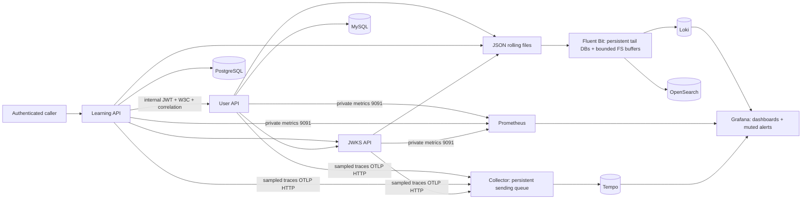

# Observability operations runbook

All commands below target `springboot_project` from the repository root. `jp_dev`
and `japanese-learning` are separate and must not be operated on by this runbook.
Routine health commands are read-only; maintenance commands require a reviewed
maintenance window and are **documented, not executed in Phase 6A**.

## Architecture and service inventory



| Compose service | Telemetry identity / data | Storage |
| --- | --- | --- |
| user-api | `user-learning`; public8080/private9091 | `user_api_logs`, MySQL |
| learning-api | `learning-api`; public8080/private9091 | `learning_api_logs`, PostgreSQL |
| jwks-api | `jwks-service`; public8080/private9091 | `jwks_api_logs`, read-only public key mounts; no database |
| fluent-bit | Tail/file collection, monitor2020 | `fluent_bit_state` |
| otel-collector | Trace receiver4318, export4317, monitor8888, health13133 | `otel_queue` |
| loki | Log query/ingest3100 | `loki_data` |
| opensearch | Search9200; local security-disabled mode | `opensearch_data`, `opensearch_logs` |
| prometheus | Scrapes/queries9090 | `prometheus_data` |
| tempo | OTLP4317, query/ready3200 | `tempo_data` |
| grafana | Authenticated UI3000 | `grafana_data` |
| mysql / postgres | Application databases | `mysql_data` / `postgres_data` |

Volume names above have prefix `springboot_project_`. Inspect actual mounts before
maintenance. Do not create a similarly named project or substitute an empty volume.
The deployed host ports are discovered from Compose; the current Grafana URL is
http://localhost:3077. Collector/Tempo/Fluent Bit have no published host ports.

## Health and safe rerunnable verification

```powershell
docker compose -p springboot_project --env-file .env -f docker-compose.yml -f docker-compose.debug.yml config --quiet
docker compose -p springboot_project ps --all
python observability/verify-phase6.py
python observability/summarize-phase6.py
python -m unittest discover -s observability -p test_phase6_tooling.py -v
```

The verifier is standard-library-only, has bounded HTTP/subprocess timeouts and
creates a new ignored run directory each time. It never installs dependencies,
deploys, restarts, sends notifications or issues direct SQL. Login/refresh/logout
use only the existing ignored test account and their own session. It refuses
unignored evidence and credential files. Never publish its raw baseline wholesale.
Exit1 is expected while verified readiness failures remain. Review the explicit
status summary; do not suppress its exit code in a production gate.

Endpoint overrides: `--endpoint grafana=http://127.0.0.1:3077` (repeat by service).
Only loopback URLs without embedded credentials are accepted. `--compose-file`
can be repeated for base/overrides, `--timeout` is1–30 seconds, `--credentials`
selects an existing ignored JSON file, `--evidence-dir` must remain Git-ignored.
The project name is fixed and container checkout labels are verified before probes.

For internal read-only checks using the existing Prometheus image tools:

```powershell
docker exec springboot_project-prometheus-1 wget -T 5 -q -O - http://otel-collector:13133/
docker exec springboot_project-prometheus-1 wget -T 5 -q -O - http://tempo:3200/ready
docker exec springboot_project-prometheus-1 wget -T 5 -q -O - http://fluent-bit:2020/api/v1/storage
docker exec springboot_project-prometheus-1 promtool check config /etc/prometheus/prometheus.yml
```

## Dashboards, logs, metrics and traces

Start with [Microservices Overview](http://localhost:3077/d/sb5-overview), select
environment/service and time range, then follow HTTP/JVM/database/security/logging/
tracing/infrastructure dashboards. Full inventories: [dashboards](dashboard-inventory.md)
and [alerts](alert-rules.md). Use the existing authenticated Grafana account.

```logql
{job="springboot",service="learning-api",environment="development"}
  | json | __error__="" | correlationId="PHASE6_CORRELATION_ID"

{job="springboot",service=~"learning-api|user-learning"}
  | json | __error__="" | traceId="ACTUAL_32_HEX_TRACE_ID"
```

```promql
up{job=~"springboot|observability"}
sb:http_requests:rate5m{environment="development"}
sb:http_errors:ratio5m{service="learning-api"}
histogram_quantile(0.95, sum by (service,environment,uri,le)
  (rate(http_server_requests_seconds_bucket{uri!~"/actuator/.*"}[5m])))
otelcol_exporter_queue_size / (otelcol_exporter_queue_capacity > 0)
hikaricp_connections_pending
```

In Tempo Explore use `{ resource.service.name = "learning-api" }`,
`{ duration > 1s }` or `{ status = error }`. Expand a JSON log's TraceID link to
resolve its sampled trace; use the trace's configured trace-to-logs action for the
reverse query. Ten-percent root sampling means not every log has a stored trace.
Correlation is an independent diagnostic, never authentication identity. Browser
click behavior still needs manual verification; the API query paths passed.

## Pipeline failure and queue recovery

Check target `lastError`, internal readiness, Grafana datasource queries and safe
component logs. A reachable metrics endpoint is not proof of successful delivery.
Compare a fresh request's correlation/trace IDs across both log stores and Tempo.

Collector queue: byte-sized64MiB, two workers, fsync and persistent `otel_queue`;
retry1–10s with no expiry. Inspect queue size/capacity and failed send attempts.
Restore Tempo connectivity before increasing capacity. Batch/application data
before queue admission remains volatile. Saturation rejects new admission; never
erase the queue DB or claim exactly-once delivery. Extra disk is needed for queue
metadata/compaction. Ordinary-restart recovery passed historically in Phase4;
crash recovery was not executed in Phase6A.

Fluent Bit: preserve its three tail SQLite DBs, WALs and filesystem chunks together.
Budgets are64M Loki and32M for each of three OpenSearch outputs, nominal160M logical
destination storage. They are not filesystem quotas. Full destinations may discard
old buffered chunks; retries are unbounded with1–10s backoff. Check per-output
errors/retries/dropped records, input overlimit flags and the internal storage API.
Do not delete tail DBs, replay archives into live current logs or add overlapping
tail inputs. Retries can produce duplicates; one observed completion per probe is
not a delivery guarantee. Lines over256KiB are skipped by existing policy.

## Compressed-rotation gap and concrete mitigation

Current contract: 100MB size/time rollover, immediate gzip,30-day/2GB archive budget
per app; tail inputs cover only the exact active filename. A stopped collector
cannot read archives already gzipped before it returns. Persistent collector
buffers cannot protect bytes never read.

Proposed compatible migration, **not deployed**: retain uncompressed rolled files
for a measured maximum collector-outage interval; tail both active and a narrowly
bounded uncompressed archive family using the same per-service DB; exclude all
`.gz` files and ensure inode/filename tracking prevents overlap/replay; compress
only after a separately verified safe collection/age watermark. Size the retention
budget from peak log bytes/s × outage window plus rollover margin. If Logback's
cleanup cannot express that guarantee, use a reviewed archive lifecycle helper
with durable state; do not pretend a fixed short delay guarantees collection.

First validate rename/late write, stop→rollover→restart, partial read, truncation,
inode reuse, delayed compression, restart and duplicate behavior in a disposable
fixture. Phase4's fixture covers some of these but explicitly not immediate
compressed rotation during collector downtime. A change touches all app logging
configs, collector path matching and retention/storage exposure; silently changing
it live is not safe. See Phase6B test A4. An alternative stdout/OTLP migration is
a separate architecture decision and must avoid dual-source duplication.

## Approved maintenance restart procedure — NOT executed in 6A

Record IDs/start times/mounts and protected hashes; verify destination health,
available disk and queue sizes; obtain a maintenance window and expiring silences
without unmuting external delivery. Operate on one exact target container at a
time, never a whole project. Example after approval:

```powershell
# Maintenance only; this was NOT run during Phase 6A.
docker restart --time 45 springboot_project-otel-collector-1
```

Use the configured stop grace for the chosen service. Restore backend readiness
first, then collector delivery, then verify fresh stored records and queue drain.
Avoid Compose dependency reruns for an ordinary restart. Changing mounts/images
requires a separate preflight and controlled recreation, not an incidental restart.
Rollback is restoring the exact reviewed config/image with the same volumes; a
queue is never "fixed" by discarding its storage. No forced crash is part of this
procedure. See [backup/restore](backup-restore.md) before any data migration.

## Disk pressure and retention

Check actual filesystem free space/inodes at every mounted storage path and alert
coverage before claiming capacity. The observed OpenSearch node filesystem has
headroom, but it is not a continuous host/backend capacity alarm. Do not infer
all volume capacity from application `disk_*` metrics. Investigate legacy
OpenSearch indices, compressed source archives, WAL, TSDB head, compaction scratch,
vendor logs, queue DB/WAL and Docker logs separately. Do not prune/delete data or
fill the host as a diagnostic. Restore capacity through a reviewed storage change
or archive policy after backup and owner approval.

Loki30d; new dated OpenSearch indices30d; Tempo72h; Prometheus15d or2GiB. Legacy
OpenSearch application indices remain unmanaged. Policy configured, assigned,
execution observed and physical deletion verified are separate states. Phase6A
verified configuration/assignment, not physical expiry deletion.

## Remediation operating change — 2026-11-12

New JSON logs reside in each existing application log volume under `spool/<app>.YYYY-MM-DD.<index>.log`, not the legacy fixed filename. The XML has no `<file>` property: filenames must remain immutable through rotation. Fluent Bit discovers both the legacy active file and stable spool files, reusing existing DB paths. Do not reset offsets, rename spool files, immediately compress them or glob renamed versions of a fixed active file; an isolated test demonstrated replay with that alternative.

The Compose read-only mount `/etc/application/logback-spring.xml` and `LOGGING_CONFIG` load version-controlled configuration independently of the reused images. API readiness was verified after sequential `--no-deps --no-build --pull never` recreations. Future restart commands must preserve the running service's original Compose file set; do not accidentally add debug overrides. Restart only the named target service, never databases or unrelated projects.

Size defaults:100MB/file,30 days,2GB cap/application, with active-file/asynchronous-cleanup allowance. Budget uncompressed bytes. Existing old gzip archives are untouched and excluded from collection; legacy fixed files should be left until drained and reconciled. No automatic deletion or backfill is authorized by this runbook. If backlog approaches the source retention or output queue budget, restore delivery or deliberately increase an approved bounded capacity before files expire. Retention alone does not acknowledge collection.

Diagnosis: check source `spool/` growth, Fluent Bit DB/buffer mount identity and output retry/error/backlog counters, then backend readiness and matching safe event IDs. Offset persistence is not dual-store acknowledgement. Possible retry duplicates must be investigated by source event identity rather than counted as independent application failures. Avoid manually editing SQLite state or replaying gzip into live inputs.

Safe repeatable checks:

```powershell
python observability/remediation-runtime.py verify
python observability/verify-remediation.py
python observability/test-rotation-remediation.py
```

The first is read-only preservation, the second issues bounded authenticated requests using an ignored existing test account and returns1 while production security remains failed, and the third creates/retains disposable labelled fixtures using existing images/cached Java dependencies. It stops only its fixture containers. Never use `deploy` again as a generic health check: it performs the logging rollout and requires its untouched initial baseline conditions.

Rollback planning: retain new spool discovery even if application logging configuration must be reverted; otherwise unread spool files become invisible. Preserve original DB/buffer/log volumes and drain/reconcile before altering paths. Reintroducing fixed-file immediate compression reintroduces the original failure. Secure production rollback is a different coordinated migration; see [candidate procedure](secure-production/README.md). No native security toggle or filled secret environment should be applied from this runbook without that migration gate.

## Phase6B laboratory operations — 2026-11-12

The reusable [lab instructions](phase6b/README.md) apply only to generated `springboot_phase6b` fixtures. They do not authorize running root Compose overrides against existing stores. Capture baseline, render/audit isolation, start, select bounded suites, preserve, collect and stop in that order. Exact labels/IDs protect mutations. Never use the probe or its multi-identity PKI mount in production.

The completed [report](phase6b-verification.md) records intentional loss under output/queue overflow; do not equate receiver HTTP200 with durable delivery. Output budgets must cover backend latency and outage volume independently. Small identical queues can lose records even at the destination that remains available. Source retention and total buffer capacity remain finite; recovery tests do not establish exactly-once or host durability.

Native OpenSearch ISM physical deletion was observed only for a new exact-target test index. Loki/Prometheus expiry and complete Tempo cohort expiry remain unverified. Do not change live retention to reproduce these fixtures. Local notification retry/repeat/recovery passed, but existing delivery mute must remain active until separately authorized external testing.

Collect evidence before stopping: tmpfs contents may disappear on final unmount. `cleanup --confirm <exact-run-id>` deletes only labelled fixture resources and is separate from safe stop; no volume-deleting cleanup was performed. Keep ignored test PKI, state artifacts and raw topology private. See the matrix for unresolved migration, durability, recovery and capacity gates.
